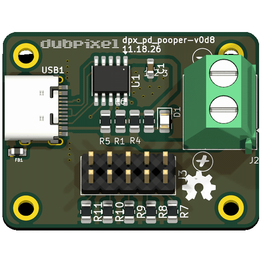

<!-- Improved compatibility of back to top link: See: https://github.com/othneildrew/Best-README-Template/pull/73 -->

<!--
*** Thanks for checking out the Best-README-Template. If you have a suggestion
*** that would make this better, please fork the repo and create a pull request
*** or simply open an issue with the tag "enhancement".
*** Don't forget to give the project a star!
*** Thanks again! Now go create something AMAZING! :D
*** /// d   u   b   p   i   x   e   l 
*** this has additionally been changed by dubpixel for the dpx_ series of projects
*** search dpx_pd_pooper .. replace COMMAND OPTION F
*** also has added kicad badge
-->

<!-- PROJECT SHIELDS -->
<!--
*** I'm using markdown "reference style" links for readability.
*** Reference links are enclosed in brackets [ ] instead of parentheses ( ).
*** See the bottom of this document for the declaration of the reference variables
*** for contributors-url, forks-url, etc. This is an optional, concise syntax you may use.
*** https://www.markdownguide.org/basic-syntax/#reference-style-links
***
-->
[![Contributors][contributors-shield]][contributors-url]
[![Forks][forks-shield]][forks-url]
[![Stargazers][stars-shield]][stars-url]
[![Issues][issues-shield]][issues-url]
[![CERN-OHL-W][license-shield]][license-url]
[![LinkedIn][linkedin-shield]][linkedin-url]

<!-- PROJECT LOGO -->
 

  

<h1 align="center">dpx_pd_pooper </h1>
<h3 align="center"><i>pd poops on tap</i></h3>

  

    ...a ch224a usb-c pd trigger board with a jumper voltage selector (9 / 12 / 15 / 20 / 28 V)
     
     
     
     
    

     <a href="https://github.com/dubpixel/dpx_pd_pooper/tree/main/"><strong>Project Here!</strong></a>
     »  
    <a href="https://github.com/dubpixel/dpx_pd_pooper/tree/main/hardware/production_files_RTG"><strong>BOM Here!</strong></a>
     » 
    <a href="https://dubpixel.github.io/dpx_pd_pooper/"><strong>Manual Here!</strong></a>
     » 
    <a href="https://dubpixel.github.io/dpx_pd_pooper/ibom/"><strong>Interactive BOM Here!</strong></a>
    ·
        
    <a href="https://github.com/dubpixel/dpx_pd_pooper/issues/new?labels=bug&template=bug-report---.md">Report Bug</a>
    ·
    <a href="https://github.com/dubpixel/dpx_pd_pooper/issues/new?labels=enhancement&template=feature-request---.md">Request Feature</a>
    

    

    
     
     
     
<!-- TABLE OF CONTENTS -->

  
Table of Contents

  <ol>
    <li>
      <a href="#about-the-project">About The Project</a>
      <ul>
        <li><a href="#built-with">Built With</a></li>
      </ul>
    </li>
    <li>
      <a href="#getting-started">Getting Started</a>
      <ul>
        <li><a href="#prerequisites">Prerequisites</a></li>
        <li><a href="#installation">Installation</a></li>
      </ul>
    </li>
    <li><a href="#usage">Usage</a></li>
    <li><a href="#roadmap">Roadmap</a></li>
    <li><a href="#contributing">Contributing</a></li>
    <li><a href="#license">License</a></li>
    <li><a href="#contact">Contact</a></li>
    <li><a href="#acknowledgments">Acknowledgments</a></li>
  </ol>

     
<!-- ABOUT THE PROJECT -->

  
<h3>About The Project</h3>

  a small usb-c power delivery (PD) trigger board. plug it into a PD charger, pick a voltage with a jumper, and get that voltage on a screw terminal.
  built to prove the WCH CH224 PD trigger IC for forthcoming dubpixel / TNG ENT INC devices (dpx_faders uses the CH224K version of this circuit).

  * board: 35.0 x 27.3 mm, 2 layer, 4x M3 holes
  * chip: CH224A, resistor-configured (no firmware, no I2C needed)
  * output: 5 V (no shunt) or 9 / 12 / 15 / 20 / 28 V by shunting one column of the VSEL header
  * status: v0d8 (CH224A) sent to production 2026-11-18. untested until the boards arrive.
  * the earlier CH224K board (v0d5, tag `ch224k`) is the tested baseline.

 
www.dubpixel.tv  - i@dubpixel.tv
 

v0d8 (CH224A) front render
![FRONT v0d8][product-front-a]

[v0d8 flip video](images/pdpooper_ch224a_flip.mp4)

Previous revision, v0d5 (CH224K, 3-position DIP switch)
![FRONT v0d5][product-front]
![REAR v0d5][product-rear]

iBOM PCB Front (v0d5)
![iBOM Front][product-pcbFront]

iBOM PCB Rear (v0d5)
![iBOM Rear][product-pcbRear]

(<a href="#readme-top">back to top</a>)

### Built With 
* [![KiCad][KiCad.org]][KiCad-url]
<!--
 * [![Next][Next.js]][Next-url]
 * [![React][React.js]][React-url]
 * [![Vue][Vue.js]][Vue-url]
 * [![Angular][Angular.io]][Angular-url]
 * [![Svelte][Svelte.dev]][Svelte-url]
 * [![Laravel][Laravel.com]][Laravel-url]
 * [![Bootstrap][Bootstrap.com]][Bootstrap-url]
 * [![JQuery][JQuery.com]][JQuery-url]
 
-->

(<a href="#readme-top">back to top</a>)

<!-- GETTING STARTED -->
## Getting Started

### Prerequisites

* a USB-C PD charger that offers the voltage you want (28 V needs a 140 W EPR charger)
* a USB-C cable
* a 2x5 header and shunts (J3) and a 5.08 mm terminal block (J2). Both are left unpopulated by the JLC order and hand-fit.
* KiCad 10 if you want to open the project

### Installation

1. Hand-fit J2 (VOUT terminal block) and J3 (VSEL 2x5 header).
2. Put one shunt on the column for the voltage you want.
3. Plug in the charger, then measure the output at J2 before connecting a load.

<!-- USAGE EXAMPLES -->
## Usage

VSEL (J3) is a 2x5 header. Shunt ONE column. Left to right on the front silk:

| column | voltage | CFG1 resistor |
|---|---|---|
| none | 5 V | none |
| 1 | 9 V | R7 6.8k |
| 2 | 12 V | R8 24k |
| 3 | 15 V | R9 56k |
| 4 | 20 V | R10 120k |
| 5 | 28 V | R11 210k |

Unplug and replug USB-C after moving the shunt. The chip reads the resistor when it negotiates, not continuously.

* PWR LED lights when VBUS is present.
* VOUT (J2) is the negotiated voltage. The board does no regulation, so the load must accept the voltage you picked.
* first power-up of the CH224A board: start on 15 V and check VHV, VBUS and CFG1 before trusting the other columns. R5 is deliberately 10k.

Full details are in the [manual page](https://dubpixel.github.io/dpx_pd_pooper/) (source in `docs/`).

### Known issues (v0d8)

* back silk text (VSEL instructions) runs past the board edge and overlaps some reference designators. Cosmetic.
* the version stamp still reads v0d8 and does not distinguish the CH224A board from the planned next spin.
* CH224A VBUS pin tolerance is contradictory in the WCH datasheet (3.8 V in section 7.1, 32 V in the abs-max table). The 10k at R5 is a first-power-up safety choice.

(<a href="#readme-top">back to top</a>)

<!-- ROADMAP -->
## Roadmap

- [x] v0d5: CH224K board with 3-position DIP switch (tag `ch224k`)
- [x] v0d8: CH224A with VSEL jumper header, 9 / 12 / 15 / 20 / 28 V (sent to production 2026-11-18)
- [ ] bench-test the CH224A board against the CH224K board, same charger
- [ ] fix the back silk overflow and bump the version stamp
- [ ] decide whether the CH224A goes into dpx_faders rev 0.8
- [ ] LCSC part numbers for J2 and J3 so JLC can place them

See the [open issues](https://github.com/dubpixel/dpx_pd_pooper/issues) for a full list of proposed features (and known issues).

(<a href="#readme-top">back to top</a>)

<!-- CONTRIBUTING -->
## Contributing

Contributions are what make the open source community such an amazing place to learn, inspire, and create. Any contributions you make are **greatly appreciated**.

If you have a suggestion that would make this better, please fork the repo and create a pull request. You can also simply open an issue with the tag "enhancement".
Don't forget to give the project a star! Thanks again!

1. Fork the Project
2. Create your Feature Branch (`git checkout -b feature/AmazingFeature`)
3. Commit your Changes (`git commit -m 'Add some AmazingFeature'`)
4. Push to the Branch (`git push origin feature/AmazingFeature`)
5. Open a Pull Request

(<a href="#readme-top">back to top</a>)

### Top contributors:

<!-- LICENSE -->
## License

Distributed under the CERN Open Hardware Licence Version 2 - Weakly Reciprocal (CERN-OHL-W-2.0). See `license.txt` for more information.

(<a href="#readme-top">back to top</a>)

<!-- CONTACT -->
## Contact

#Joshua Fleitell - i@dubpixel.tv

Project Link: [https://github.com/dubpixel/dpx_pd_pooper](https://github.com/dubpixel/dpx_pd_pooper)

(<a href="#readme-top">back to top</a>)

<!-- ACKNOWLEDGMENTS -->
## Acknowledgments

* WCH CH224A / CH224K datasheets
* [Best-README-Template](https://github.com/othneildrew/Best-README-Template)

(<a href="#readme-top">back to top</a>)

<!-- MARKDOWN LINKS & IMAGES -->
<!-- https://www.markdownguide.org/basic-syntax/#reference-style-links -->
[contributors-shield]: https://img.shields.io/github/contributors/dubpixel/dpx_pd_pooper.svg?style=for-the-badge
[contributors-url]: https://github.com/dubpixel/dpx_pd_pooper/graphs/contributors
[forks-shield]: https://img.shields.io/github/forks/dubpixel/dpx_pd_pooper.svg?style=for-the-badge
[forks-url]: https://github.com/dubpixel/dpx_pd_pooper/network/members
[stars-shield]: https://img.shields.io/github/stars/dubpixel/dpx_pd_pooper.svg?style=for-the-badge
[stars-url]: https://github.com/dubpixel/dpx_pd_pooper/stargazers
[issues-shield]: https://img.shields.io/github/issues/dubpixel/dpx_pd_pooper.svg?style=for-the-badge
[issues-url]: https://github.com/dubpixel/dpx_pd_pooper/issues
[license-shield]: https://img.shields.io/badge/license-CERN--OHL--W--2.0-blue?style=for-the-badge
[license-url]: https://github.com/dubpixel/dpx_pd_pooper/blob/main/license.txt
[linkedin-shield]: https://img.shields.io/badge/-LinkedIn-black.svg?style=for-the-badge&logo=linkedin&colorB=555
[linkedin-url]: https://linkedin.com/in/jfleitell
[product-screenshot]: images/screenshot.png
[product-front-a]: images/pdpooper_ch224a_front.png
[product-front]: images/front.png
[product-rear]: images/rear.png
[product-pcbFront]: images/pcb_front.png
[product-pcbRear]: images/pcb_rear.png
[Next.js]: https://img.shields.io/badge/next.js-000000?style=for-the-badge&logo=nextdotjs&logoColor=white
[Next-url]: https://nextjs.org/
[React.js]: https://img.shields.io/badge/React-20232A?style=for-the-badge&logo=react&logoColor=61DAFB
[React-url]: https://reactjs.org/
[Vue.js]: https://img.shields.io/badge/Vue.js-35495E?style=for-the-badge&logo=vuedotjs&logoColor=4FC08D
[Vue-url]: https://vuejs.org/
[Angular.io]: https://img.shields.io/badge/Angular-DD0031?style=for-the-badge&logo=angular&logoColor=white
[Angular-url]: https://angular.io/
[Svelte.dev]: https://img.shields.io/badge/Svelte-4A4A55?style=for-the-badge&logo=svelte&logoColor=FF3E00
[Svelte-url]: https://svelte.dev/
[Laravel.com]: https://img.shields.io/badge/Laravel-FF2D20?style=for-the-badge&logo=laravel&logoColor=white
[Laravel-url]: https://laravel.com
[Bootstrap.com]: https://img.shields.io/badge/Bootstrap-563D7C?style=for-the-badge&logo=bootstrap&logoColor=white
[Bootstrap-url]: https://getbootstrap.com
[JQuery.com]: https://img.shields.io/badge/jQuery-0769AD?style=for-the-badge&logo=jquery&logoColor=white
[JQuery-url]: https://jquery.com 
[KiCad.org]: https://img.shields.io/badge/KiCad-v10-blue
[KiCad-url]: https://kicad.org 
